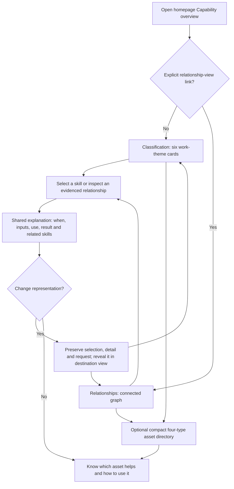
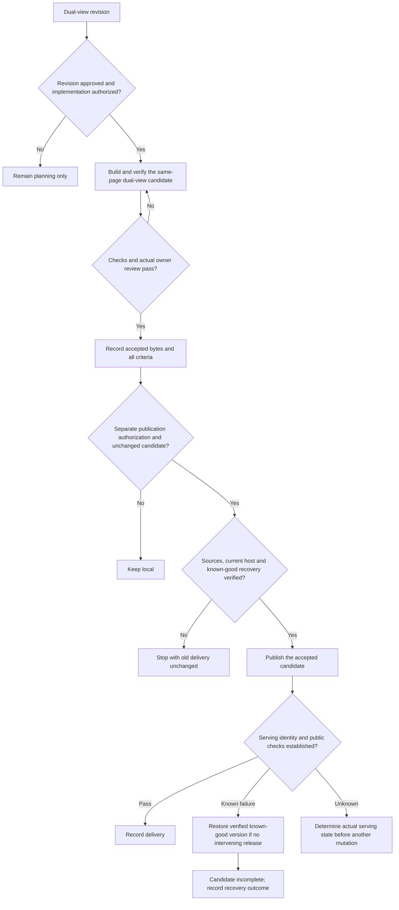

# Functional design: discover Cortex assets through work relationships

Final delivery (2026-10-28): the owner approved the dual-view documents,
accepted T12, approved the address compatibility repair and authorized T13.
Sites version 8 is published and public verification passes on the unchanged
accepted runtime. T9/T12/T13 are Done. Earlier dated planning/local records retain
their historical scope; current outcome is the [published audit](../calibration/audit-docs.md#aic-req-04-published-and-publicly-verified-2026-10-28).

## Goal

Readers find relevant skills and understand their use and real relationships through two complementary views in one homepage capability section.

## Functional modules and boundaries

| Module | Responsibility | Boundary / trace |
| --- | --- | --- |
| Homepage sections | Introduce value, expose capability discovery, compact four-type lookup and adoption | Same page per language; no independent work-relations product area. Covers R9/A13 |
| Dual-view capability host | Switch Classification / Relationships and own selection/explanation state | One visible renderer, one shared detail surface; switching never executes work. Covers R4/R12/A4/A17 |
| Classification | Preserve the original six rectangular work-theme cards and in-card skill disclosure | Classification ownership is not a skill parent/call. Covers R1/R11/A5/A6/A16 |
| Relationships | Show direct work/skill relations, loops and cross-cutting support | No fabricated global sequence or hidden prerequisite. Covers R3/R11/A3/A14/A16 |
| Shared asset explanation | Names, IDs, purpose, four usage fields, conditions, evidence and contextual boundaries | Same records in both views; passive assets remain fully indexed separately. Covers R1/R5/R10/A7/A15 |
| Lookup and optional request aid | Reveal assets in the active view and preserve request/copy identity | No compulsory copy/install/execution; no view change forced by search. Covers R6/A7/A17 |
| Delivery verification | Identify candidate, verify locally, record actual owner acceptance, then separately authorized public delivery | Previous local checks do not verify the changed scheme. Covers R7/R8/A9-A12 |

## Business workflow

This is the reader's exploration, not an execution sequence. Covers R2-R6/R11/R12.

### Delivery workflow and authorization

The owner approved the dual-view revision and explicitly authorized T20-T25 local implementation on 2026-10-28. Applicable document approval and an explicit implementation instruction precede local coding. Verification and actual
owner feedback precede accepted candidate identity; separate release authorization
precedes any public mutation. The earlier T16-T19 approval is historical, not
approval of these new decisions. Covers R7/R8.

## Delivery candidate states

| State | Entry / transition | Permitted outcome |
| --- | --- | --- |
| Local candidate | Applicable approval and implementation instruction | Local repair or verified owner acceptance |
| Integrated accepted | A1-A11/A13-A17 pass for identified bytes and actual owner result | Separately authorized public verification; changed bytes reopen checks |
| Public verification | Authorized candidate confirmed serving | Delivered or recovery outcome; unknown identity blocks mutation |
| Delivered | All A12 checks pass | Terminal success for this candidate |
| Deferred | Instruction withdrawn or pre-switch dependency fails | Old delivery unchanged; candidate incomplete |
| Recovered incomplete | Failed candidate replaced with verified known-good bytes | Candidate remains incomplete |
| Recovery unresolved | Actual version/recovery cannot be established | Stop conflicting mutations and report next action |

## Roles and permission matrix

These are delivery responsibilities; the website adds no account/approval service.

| Role | Menu / navigation | Operations | Data / evidence |
| --- | --- | --- | --- |
| Visitor | Public homepage sections and two local views | Read, select, switch and optionally copy; no real project operation | Public guidance/source records, ephemeral local UI state |
| Owner | Local candidate and evidence | Approve documents, review candidate and separately authorize release | Actual identified conclusion; no approval inferred from silence |
| Maintainer | Local tooling and separately authorized release controls | Implement only when authorized; verify and record; do not invent owner acceptance | Scoped source/evidence maintenance, remote mutation only when authorized |

## Exception and edge scenarios

| Trigger | Reader-facing result | Trace |
| --- | --- | --- |
| First entry without a valid explicit view | Classification opens; no forced selection | A4/A17 |
| Switch after editing request or during copy | Same selection/detail/text/token; no reset, duplicate copy or false success | A17/QAS-03/QAS-04 |
| Target branch was collapsed | Reveal selected skill and its owner; preserve other compatible saved state | A5/A6/A17 |
| Multiple coordinator callers or feedback cycle | Show canonical skill plus labeled references/return links, not duplicate ownership or recursive tree | A16 |
| No evidence of order | Show peers; do not number as required steps | A3/A16 |
| Lookup/peer crosses category | Reveal in the current view; only a genuinely different work context updates request defaults | A5/A17/R6 |
| Skill no longer exists | Source/registry verification fails; disclose drift rather than select another skill silently | A5/A10 |
| Switch control used by keyboard | Selected control remains focused; hidden view has no tabbable nodes | A8/A17 |
| Details closed or selected branch collapsed | Close shared explanation and focus a visible active-view opener/disclosure | A6/A8 |
| Scripts disabled or entry fails | Readable native classification/directory, section/type links and source fallback remain; relation/switch enhancement is unavailable | A10/A13 |
| Contradictory sequence in one scenario | Block source/acceptance check; distinguish missing order evidence from actual feedback | A3/A16 |
| History switch while lookup is modal | Keep modal open/query and focus trap; no focus jump behind the dialog | A8/A17 |
| Relation/support opened after selecting a skill | Preserve active target, condition/source and request through switching; remembered skill cannot replace the detail | A17 |
| Legacy explorer URL opened | Resolve into homepage capability section with Relationships requested; no second interactive page | A13 |
| Copy unavailable/rejected/stale | Keep editable text/manual recovery; feedback belongs to original request | A7/QAS-03 |
| Release fails before switch / after switch / unknown outcome | Leave old delivery / verified recovery / establish serving state before further action | A12/QAS-06 |

## UI and interaction flow

### Site information architecture

Home retains its original introduction and adoption purpose from
[AIC-REQ-02](../requirements-planning/AIC-REQ-02.md). Capability overview and Asset
directory are sections of that same document, not separate interactive destinations.

| Surface | Responsibility and placement |
| --- | --- |
| Home | Value, concise asset model, contextual links and adoption guidance |
| Capability overview | Existing homepage capability area: local Classification / Relationships switch, one active renderer and one shared explanation |
| Classification | Original six work themes: research/opportunity, direction/planning, design/verification, delivery/release, communication/integration, project/asset maintenance. Expand skills in their rectangular card. Theme numbers, if retained, are category labels, never execution step numbers. |
| Relationships | Reuse the current topic graph as the complementary renderer with source-backed skill/work connections and support scope |
| Asset directory | Compact complete Skill/Spec/Protocol/Rule index; no second six-theme card presentation. It may link to selecting a skill in the active capability view or its canonical definition. |
| Get started | Existing installation guidance; no execution feature |

Common navigation stays Home / Capability overview / Asset directory plus Get
started action and separate language/theme utilities. Capability navigation targets
the homepage section, not the old explorer page. Existing directory/type/install
and six category bookmarks remain meaningful through mapped targets. The old
`#capabilities` now denotes the unified capability host; its former directory
meaning is explicitly replaced, with complete lookup retained in the new directory
section. New section navigation within the already loaded page uses fragment/view state
updates without document reload or shared-state reset; a cold native link may load
the page. Existing work-category anchors default to the matching Classification
card when no explicit view is provided. An explicit Relations view takes precedence:
keep graph overview and a category-context hint, without inventing a selected
skill or forcing multiple graph topics open. Language switching maps matching homepage section/view; ephemeral skill,
request and scroll persistence across languages/reloads is not promised. Covers A13.

### Skill order and parent/child semantics

| Relationship | Visible expression in classification disclosure and shared details | Relationship-view equivalent |
| --- | --- | --- |
| Category owns a skill | Card heading and membership | Skill's unique work-topic owner; different grouping is allowed |
| Coordinator invokes skill | Indented child with required or conditional-call label and condition | Directed call with the same source/condition |
| Order established by source | Labeled partial sequence showing handoff/condition; independent alternatives are peers | Directed dependency/sequence with identical meaning |
| Existing artifact input | Name the required material; no demand to rerun a producer | Input edge, not automatic invocation |
| Method reuse / recommendation | Labeled related reference, not child | Method/recommendation relation, not call |
| Feedback/recheck | Explicit return link/loop | Same feedback cycle, not expanded recursively |
| Child shared by callers | One primary entry per view; secondary references identify the caller and navigate to it | Multiple evidenced call links to the same ID |

Only source-backed calls form parent/child indentation. A call can be optional
without changing its real direction. Required/conditional labels are relative to
the parent route and stated scenario, never universal instructions to all readers.
A sequence requires compatible scenario evidence; missing evidence means order
is unspecified, not proven parallelism. Two contradictory sequence directions in
one scenario are a source defect that blocks acceptance, not a feedback loop. Parent/child means coordinator responsibility,
not category membership. If nesting would duplicate a primary skill or create a
cycle, retain canonical ownership and show a labeled reference instead. Cross-card
children are navigable references; do not create long crossing strokes between
cards. The original cards' output arrows are reviewed as content examples, not copied
as execution order; remove or relabel them where no source establishes sequence.
Browse order among unrelated peers is stable and explicitly non-execution
order. Audit the existing curated graph rather than automatically converting all
53 edges into children. Covers A3/A16/R11.

### Switching and shared state

Classification is default; an explicit supported link may enter Relationships.
Use two labeled local buttons with a visible active state, programmatic pressed
state and keyboard operation; no perspective metaphor, dropdown or extra webpage.
The switch remains reachable beside the capability heading, distinct from global
navigation. One renderer is visible and keyboard-accessible at a time.

| State | Switch behavior |
| --- | --- |
| Selected skill and work context | Same canonical ID and logical work context; derive destination card/topic without resetting work |
| Work-topic explanation with no skill selected | Keep the same logical work detail; reveal matching categories in Classification or that work topic in Relationships, without choosing a default skill. Opening a classification card alone only changes its disclosure. |
| Selected relation or support explanation | Preserve the explicit active explanation target and its condition/source even if a prior selected skill remains. Reveal this target's endpoint/provider, not the stale skill; do not change detail mode or request. |
| Shared detail open/mode | Same open state, explicit target kind/ID and mode; closed stays closed. Relationship/support explanation is distinct from a skill's own relationship-list mode. |
| Edited request and copy result/token | Exact text/version/in-flight token retained; switch alone never invokes work or copy |
| Category/topic disclosure | Each view has its own saved open branches; destination reveals selection as a necessary override |
| Scroll/pan and local list position | Remember separately per view; restore on return, except minimal adjustment needed to show selected skill/owner |
| Lookup query/results/open state | Shared; switching does not close/reset lookup or force another view |
| Focus | User switch keeps focus on its button. History-driven switching with an open lookup preserves its modal focus trap; closing lookup returns to visible lookup trigger. Closing detail later resolves the active target's visible opener/disclosure or switch fallback. Hidden-view nodes are inert. |

Default classification can open multiple cards independently. Relationship view
retains its zero/one expanded work-topic rule and graph-local panning. On return,
restore each view's prior layout without imposing one view's grouping on the other.
Search/peer/directory selection reveals the target in the active representation.
Normal selection of a different work still follows R6; merely switching does not.
The active explanation target is independent of the remembered selected skill.
Opening a skill, work, relation or support target changes that target explicitly;
a representation switch changes neither. Only an actual logical work-context change may
apply the existing announced request-default policy; a new explanation target
within the same work never replaces edited text; no old promise callback can
reset the new target. With details closed, a remembered selected skill can remain
highlighted without reopening its details. Collapsing a selected card/topic clears
its active selection and detail, invalidates its pending copy and focuses the
disclosure, so the next switch does not immediately reopen a deliberately closed
branch. Inactive view layouts are not changed by this explicit active-view collapse.

No persistent user project data or selection storage is added. Covers A4/A6/A17.

### Reuse, appearance and assets

Retain brand, native HTML/ESM, themes, low motion, compact wrapping names/IDs/purposes
and source-grounded four-field guidance. Classification reuses the existing six
homepage cards; Relationships reuses the current local graph. Shared details sit
beside the capability content on desktop and use the already bounded mobile sheet;
long child lists scroll locally, and graph panning is restricted to the graph.
Both keep selected skill and owner visible and leave close/switch controls reachable.
The existing `eli5` and `design-taste-frontend` direction remains restrained and
concrete (variance/motion/density 6/3/3); no new visual system or external source is
needed for this documentation revision.

Local visual references are the [original homepage](../../website/zh.html),
[verified relation overview](../../tests/website/evidence/revision/zh/local-branch-1280-overview.png)
and [mobile detail](../../tests/website/evidence/revision/zh/local-branch-390.png).
These show reusable baselines, not an implemented dual-view prototype. No new pixel
mockup is required to plan this bounded reuse; actual UI verification is mandatory
once implementation is authorized. Contextual ordinary-agent/Cortex boundaries,
internal skill public entry, source fallback, passive types and request recovery
retain their prior meanings. Cross-cutting support appears in both representations.

Preserve-mode typography follow-up (2026-10-28): the owner's explicit
`design-taste-frontend` invocation authorizes local visual refinement. Use
variance/motion/density 3/2/5 for this information-focused surface. Keep the
six-category/graph model, interaction contract, brand, native stack and imagery.
Skill identifiers, purposes and call conditions have distinct readable type levels;
topic names use natural word wrapping, with counts below the title. This repairs
the existing pattern rather than adding a new interface or significant workflow;
no new UI decision artifact or external reference is needed. The
[refinement evidence](../../tests/website/evidence/taste/README.md) replaces the
prior candidate identity for owner review; actual T9/T12 acceptance and publication are recorded in the final delivery audit.

### Acceptance handoff

Maintainers verify both editions at 360/390/1024/1280/1440 widths, both themes,
pointer and keyboard. Cover every skill in both views, real parent/call order and
counterexamples, repeated bidirectional switching from usage/relations/work and
closed/no-selection states, edited/in-flight copy, query retention, active relation/support after prior skill selection, modal history focus, explicit collapse followed by switching, same-page anchor navigation without reload, disclosures,
scroll/pan, focus/hidden nodes, compact directory and legacy/type/install links.
Record geometry, contrast, root closure/cache, source/locale parity and actual
visual inspection separately from engineering/alignment review. T9/T12 owner
review addresses coverage, accurate order/hierarchy, findable use, site structure,
support scope, naming and switching continuity on identified bytes. No quiz or
real execution/copy is required.

At separately authorized publication, repeat both editions' direct section and
legacy-route delivery, both view entries and switches, one coordinator's hierarchy
and conditional sequence, selected skill/guidance continuity, edited request,
keyboard close/focus, complete directory/type/install links, language/theme,
script-free/blocked-entry fallback and all-file TLS/MIME/hash checks. At minimum
360 and 1280 widths in both themes; no local result substitutes for public smoke.
Any changed bytes reopen affected checks and owner acceptance. Covers A9-A12/A16/A17.

## Acceptance criteria

- **F1**: Selected help exposes contribution, inputs and outcome in either view. Covers A1/R2.
- **F2**: Ordinary-agent and Cortex boundaries remain contextual. Covers A2/R1/R5.
- **F3**: Every relation/sequence exposes direction, condition and evidence without fabricated order. Covers A3/A16/R3/R11.
- **F4**: One capability host switches renderers while preserving shared and compatible local state. Covers A4/A6/A17/QAS-04.
- **F5**: Each current skill has one primary entry per view; references/search reveal actual ownership. Covers A5/A6/QAS-02.
- **F6**: Shared localized guidance and optional truthful request recovery retain their meaning. Covers A7/QAS-03/R6.
- **F7**: Both views/switch/detail satisfy A8 matrix, keyboard/focus, visibility and contrast. Covers A8/QAS-01.
- **F8**: Native fallback, source identity and evidence claims remain truthful. Covers A10/R7.
- **F9**: Self-check and owner review cover both views of the identified revision separately. Covers A9/R7.
- **F10**: Website-root bilingual assembly preserves installation, compact full lookup, language/theme and compatibility. Covers A11/A13/QAS-05.
- **F11**: Publication requires actual acceptance of changed scope and separate authorization; verify serving state and distinct failure/recovery outcomes. Covers A12/R7/R8/QAS-06.
- **F12**: Same-page navigation/sections, compact directory and legacy/type/category links match the site architecture above. Covers A13/R9.
- **F13**: Cross-cutting support remains visible and source-backed in both views. Covers A14/R10.
- **F14**: Chinese names, canonical IDs and purposes stay distinguishable and searchable through retained lookup. Covers A15/R10.
- **F15**: Required/conditional parent calls, partial order, artifact inputs, independent peers, shared children and cycles follow the semantic table in both renderers. Covers A16/R11.
- **F16**: Both-way switching preserves all shared state and restores compatible view-local state with visible selection and correct keyboard focus. Covers A17/R12.

## Trade-offs and open questions

Two representations add implementation/state verification cost but let readers
choose classification or actual connections without leaving the page. A graph-only
entry raised initial reading burden; classification-only hides cross-topic context.
Separate pages duplicate navigation and lose local context, so are rejected for
this revision. Keeping a compact full index costs additional content reconciliation
but preserves passive-asset coverage without repeating a second six-card overview.

There is no unresolved product choice about default view, same-page placement,
relationship meaning or state retention. Exact per-edge hierarchy/sequence evidence
is a bounded source audit in T20, not permission to invent dependencies. This is a
approved revision with authorized local implementation; actual T9/T12 owner acceptance is recorded in the final delivery audit.
