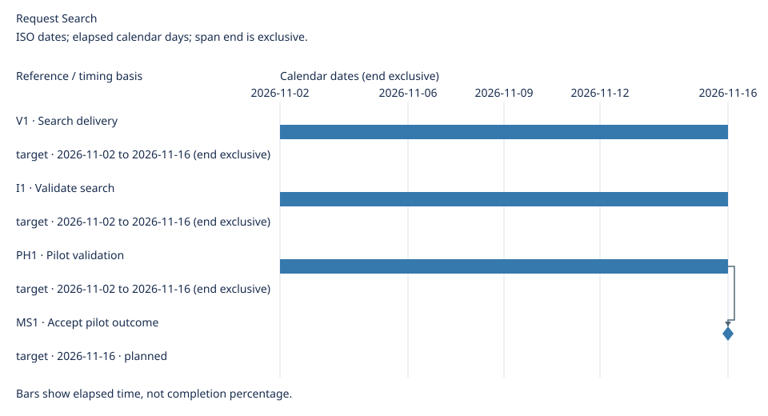
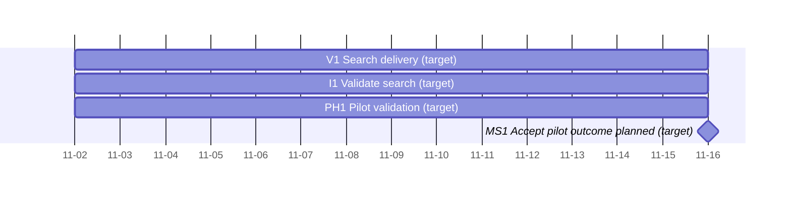

# Request Search Delivery Details

[Main roadmap](roadmap.md)

Updated: 2026-10-21

Generated view; maintain linked source records.

## Delivery plan

### Iterations

Cadence: Two-week iterations

| Iteration | Goal | Timebox / basis | Members | Versions touched | Owner | Source | Execution detail |
| --- | --- | --- | --- | --- | --- | --- | --- |
| I1 · Validate search | Validate request lookup | target · 2026-11-02 to 2026-11-16 (end exclusive) | R1 | V1 | Product team | [Source](../sources.md#i1) | [Board](../sources.md#board) |

Iteration boundaries do not prove completion, reach milestones or authorize release.

### Versions

| Version | Members | Core outcome | Owner | Delivery window |
| --- | --- | --- | --- | --- |
| V1 · Search delivery | R1 | Search is usable | Release coordinator | Target: 2026-11-02 to 2026-11-16 (end exclusive) |

### Phases

| Phase | Scope | Owner | Exit condition | Source |
| --- | --- | --- | --- | --- |
| PH1 · Pilot validation | V1 | Acceptance owner | Pilot acceptance is signed | [PH1](../sources.md#ph1) |

### Milestones

| Milestone | Category | Related | Owner | State | Occurrence criterion | Source | Evidence |
| --- | --- | --- | --- | --- | --- | --- | --- |
| MS1 · Accept pilot outcome | approval | V1, PH1 | Acceptance owner | planned | Acceptance receipt is recorded | [Source](../sources.md#ms1) | — |

Milestones are events; dates and related work do not prove occurrence or grant approval.

## Timeline

ISO dates; elapsed calendar days; span end is exclusive.

Elapsed calendar days / whole weeks; spans have exclusive ends.

Timing details

| Reference | Kind | Timing basis | Window | Depends on |
| --- | --- | --- | --- | --- |
| V1 | span | target | 2026-11-02 to 2026-11-16 (end exclusive) | None |
| I1 | span | target | 2026-11-02 to 2026-11-16 (end exclusive) | None |
| PH1 | span | target | 2026-11-02 to 2026-11-16 (end exclusive) | None |
| MS1 | milestone | target | 2026-11-16 | PH1 |

