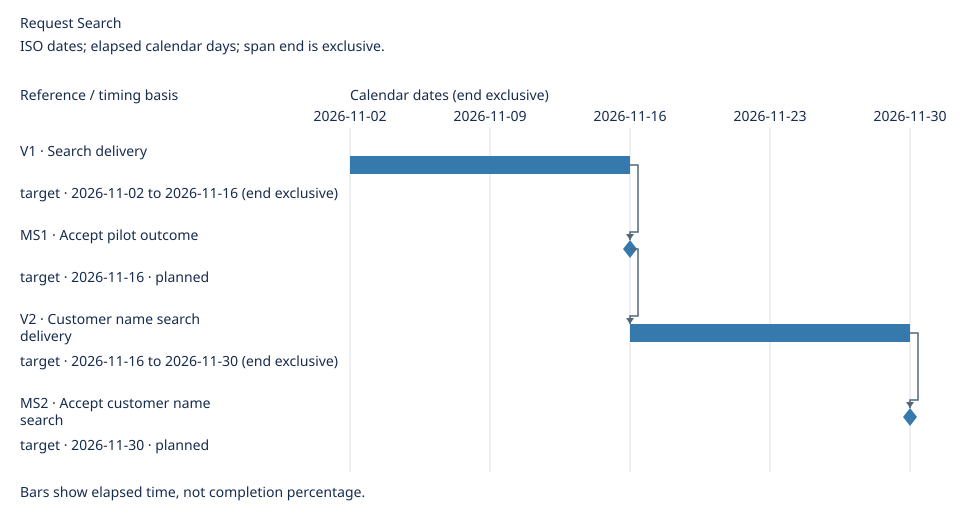
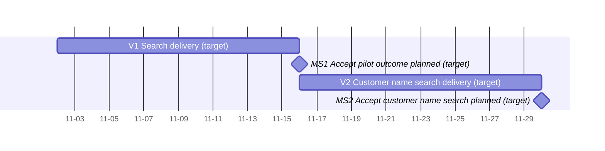

# Request Search Delivery Details

[Main roadmap](roadmap.md)

Updated: 2026-10-21

Generated view; maintain linked source records.

## Delivery plan

### Versions

| Version | Members | Core outcome | Owner | Delivery window |
| --- | --- | --- | --- | --- |
| V1 · Search delivery | [R1 · Find requests by reference](../sources.md#r1), [R4 · Filter requests by status](../sources.md#r4) | Search is usable | Release coordinator | Target: 2026-11-02 to 2026-11-16 (end exclusive) |
| V2 · Customer name search delivery | [R2 · Find requests by customer name](../sources.md#r2) | Requests are findable by customer name | Release coordinator | Target: 2026-11-16 to 2026-11-30 (end exclusive) |

Unassigned: BUG1, R3.

### Milestones

| Milestone | Category | Related | Owner | State | Occurrence criterion | Source | Evidence |
| --- | --- | --- | --- | --- | --- | --- | --- |
| MS1 · Accept pilot outcome | approval | V1 | Acceptance owner | planned | Acceptance receipt is recorded | [Source](../sources.md#ms1) | — |
| MS2 · Accept customer name search | approval | V2 | Acceptance owner | planned | Customer name search acceptance receipt is recorded | [Source](../sources.md#ms2) | — |

## Timeline

ISO dates; elapsed calendar days; span end is exclusive.

Elapsed calendar days / whole weeks; spans have exclusive ends.

Timing details

| Reference | Kind | Timing basis | Window | Depends on |
| --- | --- | --- | --- | --- |
| V1 | span | target | 2026-11-02 to 2026-11-16 (end exclusive) | None |
| MS1 | milestone | target | 2026-11-16 | V1 |
| V2 | span | target | 2026-11-16 to 2026-11-30 (end exclusive) | MS1 |
| MS2 | milestone | target | 2026-11-30 | V2 |

No schedule assigned: BUG1, R3.

