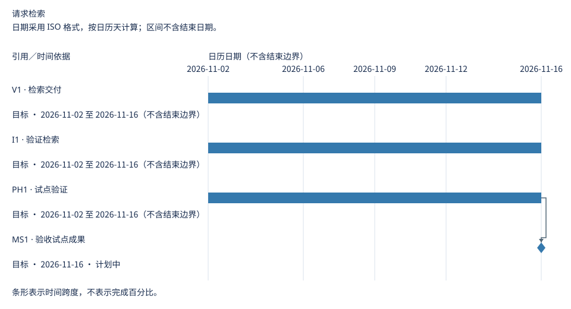
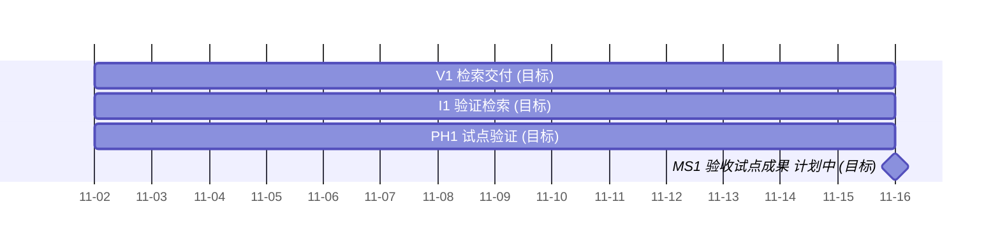

# 请求检索 交付明细

[主路线图](roadmap.md)

更新日期：2026-10-21

此为生成视图；请维护链接指向的源记录。

## 交付计划

### 迭代

迭代节奏：每两周一次迭代

| 迭代 | 目标 | 时间盒／时间依据 | 成员需求 | 关联版本 | 负责人 | 来源 | 执行明细 |
| --- | --- | --- | --- | --- | --- | --- | --- |
| I1 · 验证检索 | 验证请求查找能力 | 目标 · 2026-11-02 至 2026-11-16（不含结束边界） | R1 | V1 | 产品团队 | [来源](../sources.md#i1) | [看板](../sources.md#board) |

迭代结束不代表工作完成、里程碑达成或获得发布授权。

### 版本

| 版本 | 成员需求 | 核心结果 | 负责人 | 交付窗口 |
| --- | --- | --- | --- | --- |
| V1 · 检索交付 | R1 | 检索能力可用 | 发布协调人 | 目标：2026-11-02 至 2026-11-16（结束日期不含在内） |

### 阶段

| 阶段 | 范围 | 负责人 | 退出条件 | 来源 |
| --- | --- | --- | --- | --- |
| PH1 · 试点验证 | V1 | 验收负责人 | 试点验收已签署 | [PH1](../sources.md#ph1) |

### 里程碑

| 里程碑 | 类别 | 关联对象 | 负责人 | 状态 | 达成条件 | 来源 | 证据 |
| --- | --- | --- | --- | --- | --- | --- | --- |
| MS1 · 验收试点成果 | 批准 | V1, PH1 | 验收负责人 | 计划中 | 已记录验收凭据 | [来源](../sources.md#ms1) | — |

里程碑表示事件；日期或关联工作本身不能证明事件发生，也不授予批准。

## 时间线

日期采用 ISO 格式，按日历天计算；区间不含结束日期。

使用自然日或整周；工作区间不含结束边界。

日程明细

| 引用 | 类型 | 时间依据 | 时间窗口 | 依赖 |
| --- | --- | --- | --- | --- |
| V1 | 工作区间 | 目标 | 2026-11-02 至 2026-11-16（不含结束边界） | 无 |
| I1 | 工作区间 | 目标 | 2026-11-02 至 2026-11-16（不含结束边界） | 无 |
| PH1 | 工作区间 | 目标 | 2026-11-02 至 2026-11-16（不含结束边界） | 无 |
| MS1 | 里程碑 | 目标 | 2026-11-16 | PH1 |

