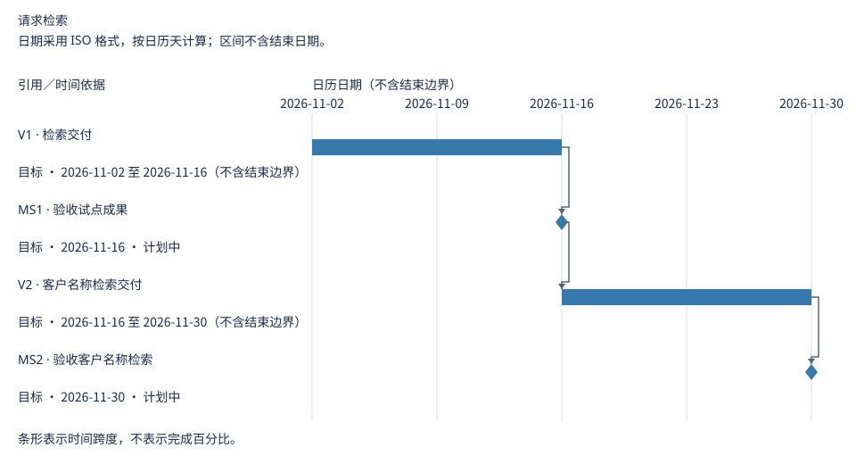
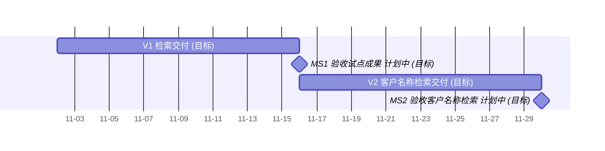

# 请求检索 交付明细

[主路线图](roadmap.md)

更新日期：2026-10-21

此为生成视图；请维护链接指向的源记录。

## 交付计划

### 版本

| 版本 | 成员需求 | 核心结果 | 负责人 | 交付窗口 |
| --- | --- | --- | --- | --- |
| V1 · 检索交付 | [R1 · 按编号查找请求](../sources.md#r1), [R4 · 按处理状态筛选请求](../sources.md#r4) | 检索能力可用 | 发布协调人 | 目标：2026-11-02 至 2026-11-16（结束日期不含在内） |
| V2 · 客户名称检索交付 | [R2 · 按客户名称查找请求](../sources.md#r2) | 可按客户名称查找请求 | 发布协调人 | 目标：2026-11-16 至 2026-11-30（结束日期不含在内） |

未分配版本：BUG1, R3.

### 里程碑

| 里程碑 | 类别 | 关联对象 | 负责人 | 状态 | 达成条件 | 来源 | 证据 |
| --- | --- | --- | --- | --- | --- | --- | --- |
| MS1 · 验收试点成果 | 批准 | V1 | 验收负责人 | 计划中 | 已记录验收凭据 | [来源](../sources.md#ms1) | — |
| MS2 · 验收客户名称检索 | 批准 | V2 | 验收负责人 | 计划中 | 已记录客户名称检索的验收凭据 | [来源](../sources.md#ms2) | — |

## 时间线

日期采用 ISO 格式，按日历天计算；区间不含结束日期。

使用自然日或整周；工作区间不含结束边界。

日程明细

| 引用 | 类型 | 时间依据 | 时间窗口 | 依赖 |
| --- | --- | --- | --- | --- |
| V1 | 工作区间 | 目标 | 2026-11-02 至 2026-11-16（不含结束边界） | 无 |
| MS1 | 里程碑 | 目标 | 2026-11-16 | V1 |
| V2 | 工作区间 | 目标 | 2026-11-16 至 2026-11-30（不含结束边界） | MS1 |
| MS2 | 里程碑 | 目标 | 2026-11-30 | V2 |

未指定日程：BUG1, R3.

