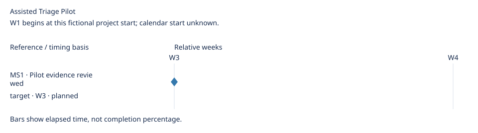

# Assisted Triage Pilot Roadmap

Updated: 2026-10-21

## Overview

Direction: Learn whether assisted triage reduces user confusion before considering rollout.

## Priority arrangement

| Tier | Requirement / defect | Priority | Approval status | Execution status |
| --- | --- | --- | --- | --- |
| Now | [R1 · Test whether users understand triage suggestions](sources.md#r1) | P1 | Approved | In progress |
| Later | [R2 · Expand triage rollout](sources.md#r2) | P2 | Draft | Not started |

No items planned: Next.

## Delivery plan

### Milestones

| Milestone | Category | Related | Owner | State | Occurrence criterion | Source | Evidence |
| --- | --- | --- | --- | --- | --- | --- | --- |
| MS1 · Pilot evidence reviewed | approval | R1 | Acceptance owner | planned | Sponsor reviews findings and records continue, adjust or stop decision | [Source](sources.md#ms1) | — |

## Timeline

W1 begins at this fictional project start; calendar start unknown.

Elapsed calendar days / whole weeks; spans have exclusive ends.

Timing details

| Reference | Kind | Timing basis | Window | Depends on |
| --- | --- | --- | --- | --- |
| MS1 | milestone | target | W3 | None |

No schedule assigned: R1, R2.

## References

[Planning basis](roadmap-planning-basis.md)
