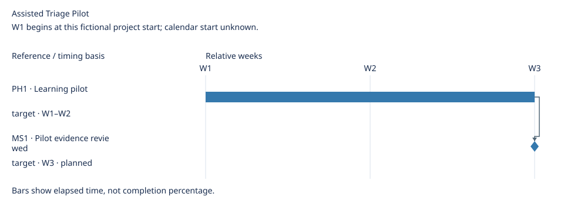

# Assisted Triage Pilot Roadmap

Updated: 2026-10-21

## Overview

Learn whether assisted triage reduces user confusion before considering rollout.

Ordering rationale: Pilot evidence must justify further investment; rollout remains directional.

Priority policy: Customer blockers P0; confirmed outcomes P1; unvalidated convenience P2. Source policy applies.

Closure criterion: Pilot findings are retained and the sponsor records continue, adjust or stop; rollout is a separate decision.

## Planning approach

Scenario: discovery · Primary: phases · Layout: single

Enabled views: requirements, phases, milestones, schedule.

Use a bounded learning phase and evidence-review event; omit speculative versions and iterations because neither is a settled delivery practice. [Selection source](selection.md#decision).

## Priority arrangement

| Tier | Requirement / defect | Expected outcome | Priority | Approval status | Execution status | Key conditions |
| --- | --- | --- | --- | --- | --- | --- |
| Now | [R1 · Validate assisted triage](sources.md#r1) | Determine whether users understand triage suggestions | P1 | Approved | In progress | [Retain findings from five pilot participants](sources.md#r1) |
| Later | [R2 · Expand triage rollout](sources.md#r2) | Extend useful assistance | P2 | Draft | Not started | [Sponsor decides from pilot evidence](sources.md#r2) |

No items planned: Next.

## Delivery plan

### Phases

| Phase | Scope | Owner | Exit condition | Source |
| --- | --- | --- | --- | --- |
| PH1 · Learning pilot | R1 | Project lead | Findings retained and sponsor records continue, adjust or stop decision | [PH1](sources.md#ph1) |

### Milestones

| Milestone | Category | Related | Owner | State | Occurrence criterion | Source | Evidence |
| --- | --- | --- | --- | --- | --- | --- | --- |
| MS1 · Pilot evidence reviewed | approval | R1, PH1 | Acceptance owner | planned | Sponsor reviews findings and records continue, adjust or stop decision | [Source](sources.md#ms1) | — |

Milestones are events; dates and related work do not prove occurrence or grant approval.

## Timeline

W1 begins at this fictional project start; calendar start unknown.

Elapsed calendar days / whole weeks; spans have exclusive ends.

Timing details

| Reference | Kind | Timing basis | Window | Depends on |
| --- | --- | --- | --- | --- |
| PH1 | span | target | W1–W2 | None |
| MS1 | milestone | target | W3 | PH1 |

No schedule assigned: R1, R2.

## Revision history

No material revisions recorded; earlier history is not certified by this input.

Backlog requirements and defects map to this roadmap; items outside it are not done by default.
Placement grants no implementation or release approval.
