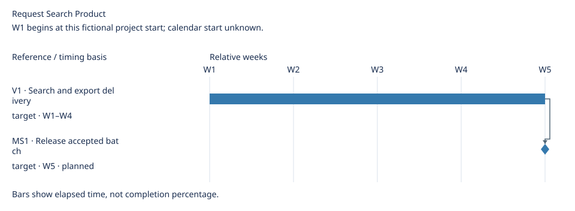

# Request Search Product Delivery Details

[Main roadmap](roadmap.md)

Updated: 2026-10-21

Generated view; maintain linked source records.

## Delivery plan

### Versions

| Version | Members | Core outcome | Owner | Delivery window |
| --- | --- | --- | --- | --- |
| V1 · Search and export delivery | [R1 · Find requests by reference](sources.md#r1), [R2 · Export search results](sources.md#r2) | Find and reuse requests | Release coordinator | W1–W4 target |

Unassigned: R3.

### Milestones

| Milestone | Category | Related | Owner | State | Occurrence criterion | Source | Evidence |
| --- | --- | --- | --- | --- | --- | --- | --- |
| MS1 · Release accepted batch | approval | V1 | Acceptance owner | planned | Acceptance and production deployment receipts recorded | [Source](sources.md#ms1) | — |

## Timeline

W1 begins at this fictional project start; calendar start unknown.

Elapsed calendar days / whole weeks; spans have exclusive ends.

Timing details

| Reference | Kind | Timing basis | Window | Depends on |
| --- | --- | --- | --- | --- |
| V1 | span | target | W1–W4 | None |
| MS1 | milestone | target | W5 | V1 |

No schedule assigned: R3.
