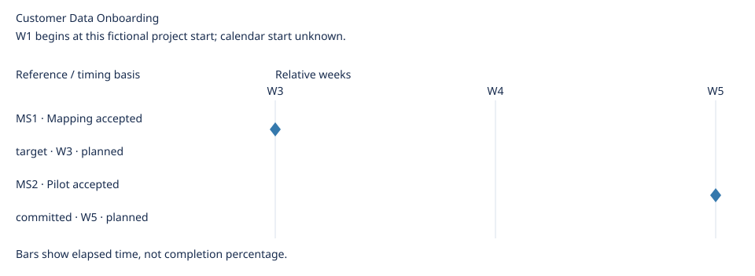

# Customer Data Onboarding Delivery Details

[Main roadmap](roadmap.md)

Updated: 2026-10-21

Generated view; maintain linked source records.

## Delivery plan

### Milestones

| Milestone | Category | Related | Owner | State | Occurrence criterion | Source | Evidence |
| --- | --- | --- | --- | --- | --- | --- | --- |
| MS1 · Mapping accepted | approval | R1 | Acceptance owner | planned | Signed mapping acceptance recorded | [Source](sources.md#ms1) | — |
| MS2 · Pilot accepted | approval | R2 | Acceptance owner | planned | Customer signs pilot acceptance | [Source](sources.md#ms2) | — |

## Timeline

W1 begins at this fictional project start; calendar start unknown.

Elapsed calendar days / whole weeks; spans have exclusive ends.

Timing details

| Reference | Kind | Timing basis | Window | Depends on |
| --- | --- | --- | --- | --- |
| MS1 | milestone | target | W3 | None |
| MS2 | milestone | committed | W5 | None |

No schedule assigned: R1, R2, R3.
