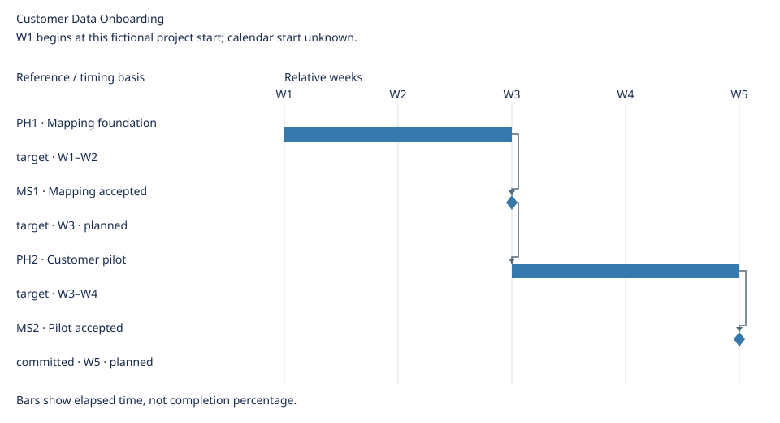

# Customer Data Onboarding Delivery Details

[Main roadmap](roadmap.md)

Updated: 2026-10-21

Generated view; maintain linked source records.

## Delivery plan

### Phases

| Phase | Scope | Owner | Exit condition | Source |
| --- | --- | --- | --- | --- |
| PH1 · Mapping foundation | R1 | Project lead | Customer approves representative mapped records | [PH1](sources.md#ph1) |
| PH2 · Customer pilot | R2 | Project lead | Customer signs pilot acceptance | [PH2](sources.md#ph2) |

### Milestones

| Milestone | Category | Related | Owner | State | Occurrence criterion | Source | Evidence |
| --- | --- | --- | --- | --- | --- | --- | --- |
| MS1 · Mapping accepted | approval | R1, PH1 | Acceptance owner | planned | Signed mapping acceptance recorded | [Source](sources.md#ms1) | — |
| MS2 · Pilot accepted | approval | R2, PH2 | Acceptance owner | planned | Customer signs pilot acceptance | [Source](sources.md#ms2) | — |

Milestones are events; dates and related work do not prove occurrence or grant approval.

## Timeline

W1 begins at this fictional project start; calendar start unknown.

Elapsed calendar days / whole weeks; spans have exclusive ends.

Timing details

| Reference | Kind | Timing basis | Window | Depends on |
| --- | --- | --- | --- | --- |
| PH1 | span | target | W1–W2 | None |
| MS1 | milestone | target | W3 | PH1 |
| PH2 | span | target | W3–W4 | MS1 |
| MS2 | milestone | committed | W5 | PH2 |

No schedule assigned: R1, R2, R3.
