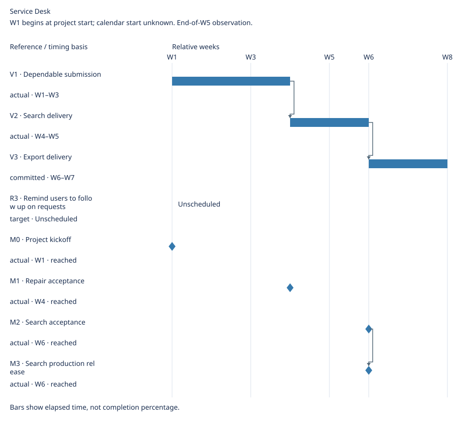

# Service Desk Roadmap

Updated: 2026-10-20

Make request handling dependable, then reduce repeated work.

## Requirements

| Tier | Requirement / defect | Priority | Approval status | Execution status |
| --- | --- | --- | --- | --- |
| Now | [BUG1 · Prevent duplicate requests on refresh and retry](../sources.md#bug1) | P0 | Approved | Completed |
| Next | [R1 · Find requests by reference](../sources.md#r1) | P1 | Approved | Completed |
| Next | [R2 · Export authorized search results](../sources.md#r2) | P1 | Approved | Not started |
| Later | [R3 · Remind users to follow up on requests](../sources.md#r3) | P2 | Draft | Not started |

## Versions

| Version | Members | Core outcome | Owner | Delivery window |
| --- | --- | --- | --- | --- |
| V1 · Dependable submission | [BUG1 · Prevent duplicate requests on refresh and retry](../sources.md#bug1) | Refresh and retry create one external request | Delivery owner | W1–W3 (actual) |
| V2 · Search delivery | [R1 · Find requests by reference](../sources.md#r1) | Find a request by reference | Delivery owner | W4–W5 (actual) |
| V3 · Export delivery | [R2 · Export authorized search results](../sources.md#r2) | Export authorized search results | Delivery owner | W6–W7 (committed) |

Unassigned: R3.

## Milestones

| Milestone | Category | Related | Owner | State | Occurrence criterion | Source | Evidence |
| --- | --- | --- | --- | --- | --- | --- | --- |
| M0 · Project kickoff | start | Global | Product owner | reached | Product owner starts the project | [Source](../sources.md#m0) | [Evidence](../sources.md#m0) |
| M1 · Repair acceptance | approval | BUG1 | Reviewer | reached | Reviewer approves BUG1 acceptance | [Source](../sources.md#m1) | [Evidence](../sources.md#m1) |
| M2 · Search acceptance | approval | R1 | Reviewer | reached | Reviewer approves R1 acceptance | [Source](../sources.md#m2) | [Evidence](../sources.md#m2) |
| M3 · Search production release | achievement | R1, V2 | Release owner | reached | Production deployment evidence for R1 recorded | [Source](../sources.md#m3) | [Evidence](../sources.md#m3) |

## Schedule

W1 begins at project start; calendar start unknown. End-of-W5 observation.

Elapsed calendar days / whole weeks; spans have exclusive ends.

| Reference | Kind | Timing basis | Window | Depends on |
| --- | --- | --- | --- | --- |
| V1 | span | actual | W1–W3 | None |
| V2 | span | actual | W4–W5 | V1 |
| V3 | span | committed | W6–W7 | V2 |
| R3 | span | target | Unscheduled | None |
| M0 | milestone | actual | W1 | None |
| M1 | milestone | actual | W4 | None |
| M2 | milestone | actual | W6 | None |
| M3 | milestone | actual | W6 | M2 |

Unscheduled: R3.

## References

[Planning basis](roadmap-planning-basis.md)

[Supplied revision details](roadmap-history.md).
