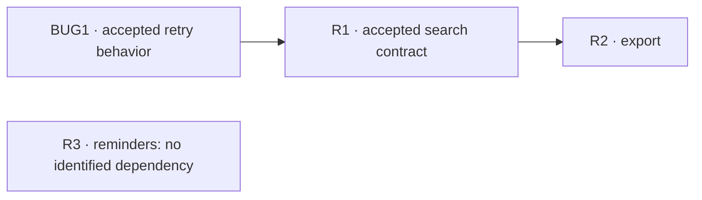

# Service Desk dependencies and blocked list

Finished W0 dependency output, with the W1 blocker update explicitly separated.
References resolve to [source records](sources.md). Technical, team, external,
knowledge and sequential categories were checked for every entry; categories not
listed in the register have no identified dependency in this fictional scenario.

## Dependency register

| ID | Depends on | Kind | Required deliverable | Owner | Need by |
| --- | --- | --- | --- | --- | --- |
| BUG1 | None | None | None | Repair owner | W1 execution |
| R1 | BUG1 | sequential | Accepted retry behavior | Repair owner | Before search starts |
| R2 | R1 | technical | Accepted result/permission contract | Search owner | Before export starts |
| R3 | None | None | None | Product owner | Re-evaluation trigger |

Cycle result: none. The fictional owners confirm the listed edges before recording
them; order alone is not used as evidence of dependency.

## W0 readiness result

| ID | May enter Now? | Reason / next condition |
| --- | --- | --- |
| BUG1 | Yes | P0; approved; no unmet prerequisite |
| R1 | No | BUG1 acceptance is pending; retain P1 and Next |
| R2 | No | R1's accepted contract is unavailable; retain P1 and Next |
| R3 | No | Draft scope and unvalidated demand; retain P2 and Later |

## W1 blocker update

BUG1 cannot complete required external acceptance because the sandbox is unavailable.
The platform owner restores it by W3; unblock on restoration. A local fixture can
support repair diagnosis but cannot waive acceptance. Keeping R1 in V1 would now
misrepresent delivery scope, so the [change record](change-record.md) moves it.

Reduction options evaluated: dropping external acceptance is rejected by project
closure policy; an interface fixture helps diagnosis but not final acceptance;
earlier sandbox restoration is assigned to the platform owner; absorbing that
platform responsibility into the feature team is not available. The unresolved
external dependency remains visible until W3, with R1 and R2 still waiting.
