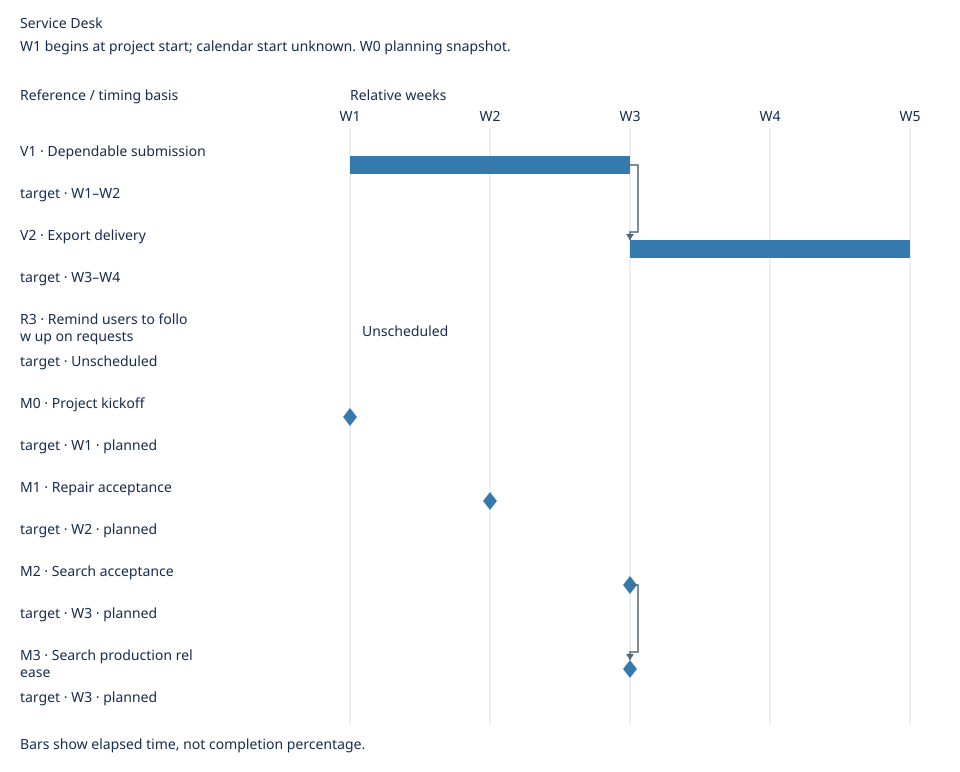

# Service Desk Roadmap

Updated: 2026-10-20

Make request handling dependable, then reduce repeated work.

## Requirements

| Tier | Requirement / defect | Priority | Approval status | Execution status |
| --- | --- | --- | --- | --- |
| Now | [BUG1 · Prevent duplicate requests on refresh and retry](../sources.md#bug1) | P0 | Approved | In progress |
| Next | [R1 · Find requests by reference](../sources.md#r1) | P1 | Approved | Not started |
| Next | [R2 · Export authorized search results](../sources.md#r2) | P1 | Approved | Not started |
| Later | [R3 · Remind users to follow up on requests](../sources.md#r3) | P2 | Draft | Not started |

## Versions

| Version | Members | Core outcome | Owner | Delivery window |
| --- | --- | --- | --- | --- |
| V1 · Dependable submission | [BUG1 · Prevent duplicate requests on refresh and retry](../sources.md#bug1), [R1 · Find requests by reference](../sources.md#r1) | Refresh and retry create one external request; Find a request by reference | Delivery owner | W1–W2 (target) |
| V2 · Export delivery | [R2 · Export authorized search results](../sources.md#r2) | Export authorized search results | Delivery owner | W3–W4 (target) |

Unassigned: R3.

## Milestones

| Milestone | Category | Related | Owner | State | Occurrence criterion | Source | Evidence |
| --- | --- | --- | --- | --- | --- | --- | --- |
| M0 · Project kickoff | start | Global | Product owner | planned | Product owner starts the project | [Source](../sources.md#m0) | — |
| M1 · Repair acceptance | approval | BUG1 | Reviewer | planned | Reviewer approves BUG1 acceptance | [Source](../sources.md#m1) | — |
| M2 · Search acceptance | approval | R1 | Reviewer | planned | Reviewer approves R1 acceptance | [Source](../sources.md#m2) | — |
| M3 · Search production release | achievement | R1, V1 | Release owner | planned | Production deployment evidence for R1 recorded | [Source](../sources.md#m3) | — |

## Schedule

W1 begins at project start; calendar start unknown. W0 planning snapshot.

Elapsed calendar days / whole weeks; spans have exclusive ends.

| Reference | Kind | Timing basis | Window | Depends on |
| --- | --- | --- | --- | --- |
| V1 | span | target | W1–W2 | None |
| V2 | span | target | W3–W4 | V1 |
| R3 | span | target | Unscheduled | None |
| M0 | milestone | target | W1 | None |
| M1 | milestone | target | W2 | None |
| M2 | milestone | target | W3 | None |
| M3 | milestone | target | W3 | M2 |

Unscheduled: R3.

## References

[Planning basis](roadmap-planning-basis.md)
