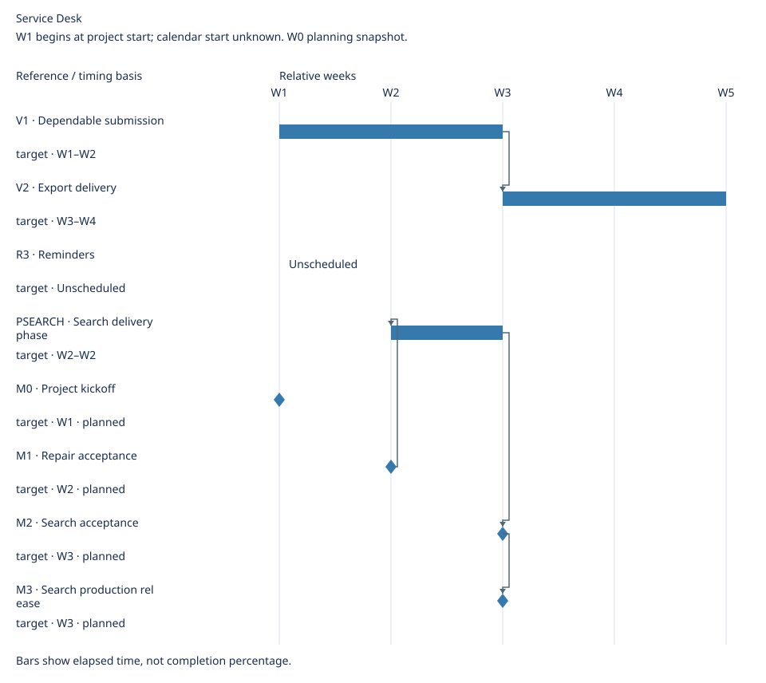

# Service Desk Roadmap

Updated: 2026-10-20

Make request handling dependable, then reduce repeated work.

Ordering rationale: Fix duplicate submission before search; export depends on accepted search. Reminders wait for demand.

Priority policy: Customer data-integrity blockers P0; confirmed capability needs P1; unvalidated convenience P2. See ../sources.md#project-policy.

## Requirements

| Tier | Requirement / defect | Expected outcome | Priority | Approval status | Execution status | Key conditions |
| --- | --- | --- | --- | --- | --- | --- |
| Now | [BUG1 · Duplicate submission](../sources.md#bug1) | Refresh and retry create one external request | P0 | Approved | In progress | [Pass external acceptance and release accepted repair](../sources.md#bug1) |
| Next | [R1 · Search](../sources.md#r1) | Find a request by reference | P1 | Approved | Not started | [Wait for accepted retry behavior](../sources.md#r1) |
| Next | [R2 · Export](../sources.md#r2) | Export authorized search results | P1 | Approved | Not started | [Wait for accepted search contract](../sources.md#r2) |
| Later | [R3 · Reminders](../sources.md#r3) | Remember requests needing follow-up | P2 | Draft | Not started | [Re-evaluate after three users demonstrate missed follow-ups](../sources.md#r3) |

Closure criterion: Acceptance passed and accepted change released to production; see ../sources.md#project-policy.

## Versions

| Version | Members | Core outcome | Owner | Delivery window |
| --- | --- | --- | --- | --- |
| V1 · Dependable submission | BUG1, R1 | Refresh and retry create one external request; Find a request by reference | Delivery owner | W1–W2 (target) |
| V2 · Export delivery | R2 | Export authorized search results | Delivery owner | W3–W4 (target) |

Unassigned: R3.

## Phases

| Phase | Scope | Owner | Exit condition | Source |
| --- | --- | --- | --- | --- |
| PSEARCH · Search delivery phase | R1 | Search owner | Search accepted and released | [PSEARCH](../sources.md#psearch) |

## Milestones

| Milestone | Category | Related | Owner | State | Occurrence criterion | Source | Evidence |
| --- | --- | --- | --- | --- | --- | --- | --- |
| M0 · Project kickoff | start | Global | Product owner | planned | Product owner starts the project | [Source](../sources.md#m0) | — |
| M1 · Repair acceptance | approval | BUG1 | Reviewer | planned | Reviewer approves BUG1 acceptance | [Source](../sources.md#m1) | — |
| M2 · Search acceptance | approval | R1, PSEARCH | Reviewer | planned | Reviewer approves R1 acceptance | [Source](../sources.md#m2) | — |
| M3 · Search production release | achievement | R1, V1 | Release owner | planned | Production deployment evidence for R1 recorded | [Source](../sources.md#m3) | — |

Milestones are events; dates and related work do not prove occurrence or grant approval.

## Schedule

W1 begins at project start; calendar start unknown. W0 planning snapshot.

Elapsed calendar days / whole weeks; spans have exclusive ends.

| Reference | Kind | Timing basis | Window | Depends on |
| --- | --- | --- | --- | --- |
| V1 | span | target | W1–W2 | None |
| V2 | span | target | W3–W4 | V1 |
| R3 | span | target | Unscheduled | None |
| PSEARCH | span | target | W2–W2 | M1 |
| M0 | milestone | target | W1 | None |
| M1 | milestone | target | W2 | None |
| M2 | milestone | target | W3 | PSEARCH |
| M3 | milestone | target | W3 | M2 |

Unscheduled: R3.

## Revision history

No material revisions recorded; earlier history is not certified by this input.

Backlog requirements and defects map to this roadmap; items outside it are not done by default.
Placement grants no implementation or release approval.
