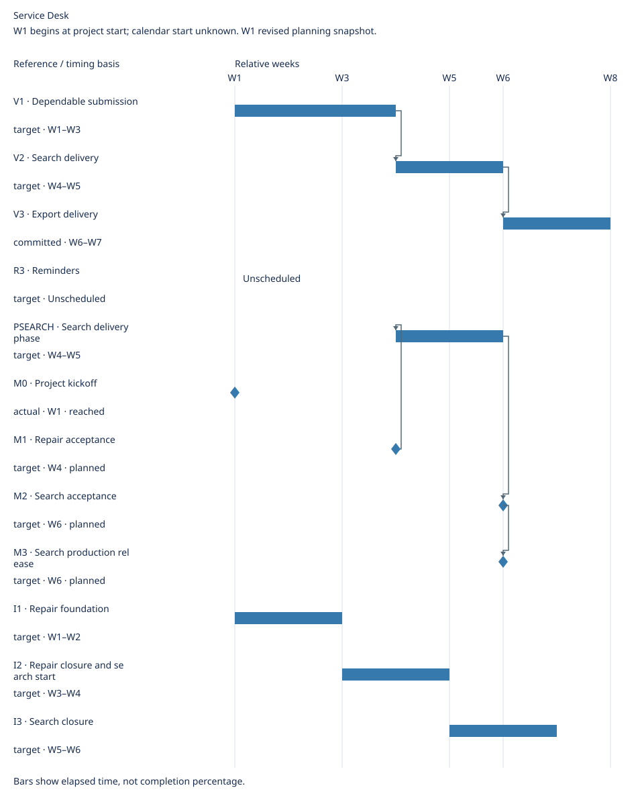

# Service Desk Delivery Details

[Main roadmap](roadmap.md)

Updated: 2026-10-21

Generated view; maintain linked source records.

## Delivery plan

### Iterations

Cadence: Two-week iterations

| Iteration | Goal | Timebox / basis | Members | Versions touched | Owner | Source | Execution detail |
| --- | --- | --- | --- | --- | --- | --- | --- |
| I1 · Repair foundation | Diagnose and validate the duplicate-submission repair | target · W1–W2 | BUG1 | V1 | Desk team | [Source](../iterations.md#i1) | [Board](../sources.md#bug1) |
| I2 · Repair closure and search start | Close the repair and start search validation | target · W3–W4 | BUG1, R1 | V1, V2 | Desk team | [Source](../iterations.md#i2) | [Board](../sources.md#r1) |
| I3 · Search closure | Complete search acceptance and release checks | target · W5–W6 | R1 | V2 | Desk team | [Source](../iterations.md#i3) | [Board](../sources.md#r1) |

Not allocated to an iteration: R2, R3.

Iteration boundaries do not prove completion, reach milestones or authorize release.

### Versions

| Version | Members | Core outcome | Owner | Delivery window |
| --- | --- | --- | --- | --- |
| V1 · Dependable submission | BUG1 | Refresh and retry create one external request | Delivery owner | W1–W3 (target) |
| V2 · Search delivery | R1 | Find a request by reference | Delivery owner | W4–W5 (target) |
| V3 · Export delivery | R2 | Export authorized search results | Delivery owner | W6–W7 (committed) |

Unassigned: R3.

### Phases

| Phase | Scope | Owner | Exit condition | Source |
| --- | --- | --- | --- | --- |
| PSEARCH · Search delivery phase | R1 | Search owner | Search accepted and released | [PSEARCH](../sources.md#psearch) |

### Milestones

| Milestone | Category | Related | Owner | State | Occurrence criterion | Source | Evidence |
| --- | --- | --- | --- | --- | --- | --- | --- |
| M0 · Project kickoff | start | Global | Product owner | reached | Product owner starts the project | [Source](../sources.md#m0) | [Evidence](../sources.md#m0) |
| M1 · Repair acceptance | approval | BUG1 | Reviewer | planned | Reviewer approves BUG1 acceptance | [Source](../sources.md#m1) | — |
| M2 · Search acceptance | approval | R1, PSEARCH | Reviewer | planned | Reviewer approves R1 acceptance | [Source](../sources.md#m2) | — |
| M3 · Search production release | achievement | R1, V2 | Release owner | planned | Production deployment evidence for R1 recorded | [Source](../sources.md#m3) | — |

Milestones are events; dates and related work do not prove occurrence or grant approval.

## Timeline

W1 begins at project start; calendar start unknown. W1 revised planning snapshot.

Elapsed calendar days / whole weeks; spans have exclusive ends.

Timing details

| Reference | Kind | Timing basis | Window | Depends on |
| --- | --- | --- | --- | --- |
| V1 | span | target | W1–W3 | None |
| V2 | span | target | W4–W5 | V1 |
| V3 | span | committed | W6–W7 | V2 |
| R3 | span | target | Unscheduled | None |
| PSEARCH | span | target | W4–W5 | M1 |
| M0 | milestone | actual | W1 | None |
| M1 | milestone | target | W4 | None |
| M2 | milestone | target | W6 | PSEARCH |
| M3 | milestone | target | W6 | M2 |
| I1 | span | target | W1–W2 | None |
| I2 | span | target | W3–W4 | None |
| I3 | span | target | W5–W6 | None |

Unscheduled: R3.
