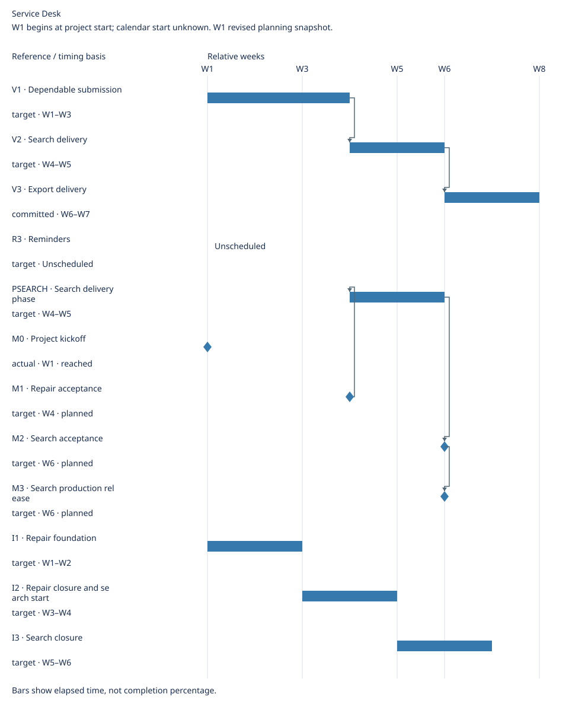

# Service Desk Roadmap

**Updated:** 2026-10-21

## Overview

**Direction and goal:** Make request handling dependable, then reduce repeated work.

**Current arrangement and rationale:** Fix duplicate submission before search; export depends on accepted search. Reminders wait for demand.

**Subsequent work and key conditions:** See delivery outlook and linked conditions.

**Material unknowns:** No additional unknowns supplied.

## Priority arrangement

**Tier summary:** Now: BUG1; Next: R1, R2; Later: R3

**Execution evidence and mapping:** Source records: [BUG1](../sources.md#bug1), [R1](../sources.md#r1), [R2](../sources.md#r2), [R3](../sources.md#r3)

| Tier | Requirement / defect | Expected outcome | Priority | Approval status | Execution status | Key conditions |
| --- | --- | --- | --- | --- | --- | --- |
| Now | [BUG1 · Duplicate submission](../sources.md#bug1) | Refresh and retry create one external request | P0 | Approved | Blocked | [Restore sandbox by W3; local fixture cannot waive acceptance](../sources.md#bug1) |
| Next | [R1 · Search](../sources.md#r1) | Find a request by reference | P1 | Approved | Not started | [Wait for accepted retry behavior](../sources.md#r1) |
| Next | [R2 · Export](../sources.md#r2) | Export authorized search results | P1 | Approved | Not started | [Wait for accepted search contract](../sources.md#r2) |
| Later | [R3 · Reminders](../sources.md#r3) | Remember requests needing follow-up | P2 | Draft | Not started | [Re-evaluate after three users demonstrate missed follow-ups](../sources.md#r3) |

[Completed and closed items](roadmap-history.md#completed-and-closed-items)

## Delivery outlook

**Cadence and basis:** Two-week iterations

| Iteration / goal | Timebox / basis |
| --- | --- |
| I1 · Diagnose and validate the duplicate-submission repair | target · W1–W2 |
| I2 · Close the repair and start search validation | target · W3–W4 |
| I3 · Complete search acceptance and release checks | target · W5–W6 |

[Iteration plan](iterations.md)

| Version / outcome | Members | Delivery window / basis |
| --- | --- | --- |
| V1 · Refresh and retry create one external request | BUG1 | W1–W3 (target) |
| V2 · Find a request by reference | R1 | W4–W5 (target) |
| V3 · Export authorized search results | R2 | W6–W7 (committed) |

[Version plan](versions.md)

| Key event | State | Timing / basis |
| --- | --- | --- |
| M0 · Project kickoff | reached | actual · W1 |
| M1 · Repair acceptance | planned | target · W4 |
| M2 · Search acceptance | planned | target · W6 |
| M3 · Search production release | planned | target · W6 |

[Milestones](milestones.md)

## Timeline

**Origin, calendar and exclusive end:** W1 begins at project start; calendar start unknown. W1 revised planning snapshot. · Elapsed calendar days / whole weeks; spans have exclusive ends.

| Reference | Kind | Timing basis | Window | Depends on |
| --- | --- | --- | --- | --- |
| V1 | span | target | W1–W3 | None |
| V2 | span | target | W4–W5 | V1 |
| V3 | span | committed | W6–W7 | V2 |
| R3 | span | target | Unscheduled | None |
| PSEARCH | span | target | W4–W5 | M1 |
| M0 | milestone | actual | W1 | None |
| M1 | milestone | target | W4 | None |
| M2 | milestone | target | W6 | PSEARCH |
| M3 | milestone | target | W6 | M2 |
| I1 | span | target | W1–W2 | None |
| I2 | span | target | W3–W4 | None |
| I3 | span | target | W5–W6 | None |

**Unscheduled work and timing exceptions:** R3

## Revision history

| Date / revision | Change (before → after) | Reason | Impact | Details |
| --- | --- | --- | --- | --- |
| 2026-10-21 · REV3 | No iteration allocation → I1–I3 goal/scope/timeboxes | Team plans in two-week cycles | Version windows, tiers and event targets unchanged; R2/R3 remain unallocated | [Details](../iterations.md#adoption-decision) |
| 2026-10-20 · REV1 | R1: V1 → V2; R2: V2 → V3; M1: W2 → W4; M2/M3: W3 → W6 | Required repair acceptance sandbox unavailable; search and export depend on accepted upstream work | Export +3 weeks; original hard deadline breached; priorities and tiers unchanged | [Details](../change-record.md#w1-plan-change) |

[Full revision history](roadmap-history.md)

## Planning basis and sources

**Priority policy:** [Priority policy](../priority-policy.md)

**Closure criterion:** Acceptance passed and accepted change released to production; see ../sources.md#project-policy.

[Planning basis](roadmap-planning-basis.md) · [Pending decisions](roadmap-planning-basis.md#pending-decisions) · [Unknown facts](roadmap-planning-basis.md#unknown-facts)
