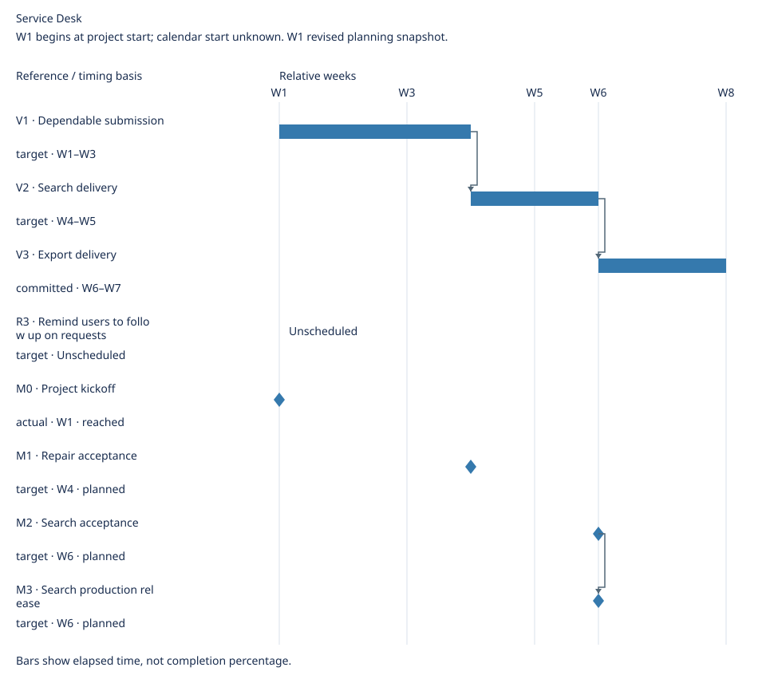

# Service Desk Roadmap

**Updated:** 2026-10-21

## Overview

**Direction and goal:** Make request handling dependable, then reduce repeated work.

**Material unknowns:** No additional unknowns supplied.

## Priority arrangement

**Tier summary:** Now: BUG1; Next: R1, R2; Later: R3

| Tier | Requirement / defect | Priority | Approval status | Execution status |
| --- | --- | --- | --- | --- |
| Now | [BUG1 · Prevent duplicate requests on refresh and retry](../sources.md#bug1) | P0 | Approved | Blocked |
| Next | [R1 · Find requests by reference](../sources.md#r1) | P1 | Approved | Not started |
| Next | [R2 · Export authorized search results](../sources.md#r2) | P1 | Approved | Not started |
| Later | [R3 · Remind users to follow up on requests](../sources.md#r3) | P2 | Draft | Not started |

**Delivery blockers**

- [BUG1](../sources.md#bug1) · Restore sandbox by W3 to run repair acceptance.

## Delivery outlook

| Version / outcome | Members | Delivery window / basis |
| --- | --- | --- |
| V1 · Refresh and retry create one external request | [BUG1 · Prevent duplicate requests on refresh and retry](../sources.md#bug1) | W1–W3 (target) |
| V2 · Find a request by reference | [R1 · Find requests by reference](../sources.md#r1) | W4–W5 (target) |
| V3 · Export authorized search results | [R2 · Export authorized search results](../sources.md#r2) | W6–W7 (committed) |

| Milestone | State | Timing / basis |
| --- | --- | --- |
| M0 · Project kickoff | reached | actual · W1 |
| M1 · Repair acceptance | planned | target · W4 |
| M2 · Search acceptance | planned | target · W6 |
| M3 · Search production release | planned | target · W6 |

## Timeline

**Origin, calendar and exclusive end:** W1 begins at project start; calendar start unknown. W1 revised planning snapshot. · Elapsed calendar days / whole weeks; spans have exclusive ends.

| Reference | Kind | Timing basis | Window | Depends on |
| --- | --- | --- | --- | --- |
| V1 | span | target | W1–W3 | None |
| V2 | span | target | W4–W5 | V1 |
| V3 | span | committed | W6–W7 | V2 |
| R3 | span | target | Unscheduled | None |
| M0 | milestone | actual | W1 | None |
| M1 | milestone | target | W4 | None |
| M2 | milestone | target | W6 | None |
| M3 | milestone | target | W6 | M2 |

**Unscheduled work and timing exceptions:** R3

## References

[Full revision history](roadmap-history.md)

[Planning basis](roadmap-planning-basis.md) · [Pending decisions](roadmap-planning-basis.md#pending-decisions) · [Unknown facts](roadmap-planning-basis.md#unknown-facts)

[Completed and closed items](roadmap-history.md#completed-and-closed-items) · [Version plan](versions.md) · [Milestones](milestones.md)
