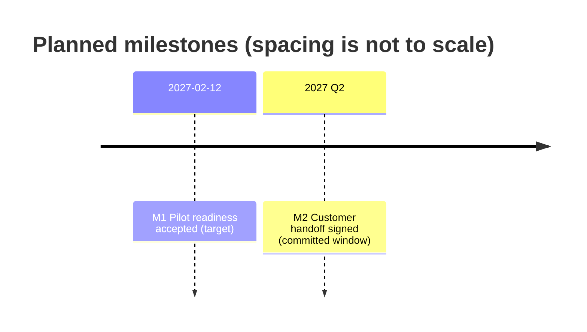

# Plan Milestones

Apply the [Roadmap Modeling Spec](../../specs/roadmap-modeling.md#milestone-planning-achievement-and-comparison)
and the [phase and event integrity rule](../../rules/roadmap-quality.md#phase-and-event-integrity).
Plan significant events with observable occurrence criteria. Select events that
matter to a decision, commitment or handoff. The project's delivery approach
determines granularity and timing precision.

## Create or revise the plan

1. Read project norms, any existing plan and the relevant goals, delivery
   constraints, commitments, dependencies and decision history. Use the project's
   chosen destination, language and document structure. A plan may live in a
   roadmap, a delivery plan, a tracker or a separate document. If ownership or
   destination is unresolved, prepare an inspectable draft and surface that gap
   before writing to a project source. Apply the Spec's
   [ownership contract](../../specs/roadmap-modeling.md#reading-order-and-document-boundaries).
2. **Create:** select key events from the available facts. Give each event a stable
   ID, a testable occurrence criterion and a source. Link related work and
   significant prerequisites where known. Record the responsible party and
   timing with the precision the source supports. Distinguish target dates or
   windows from confirmed commitments. Keep missing information visible. An
   unresolved owner, date or prerequisite stays open for the project to settle.
3. **Revise:** match by existing ID and retain the event identity while the scope
   and criterion remain comparable. If either changes materially, record the
   change explicitly and identify comparisons or downstream plans affected by it.
   Apply the [revision contract](../../specs/roadmap-modeling.md#54-revision-records)
   for material decisions. Record the before and after, reason, impact and source.
   Separate confirmed impact from dependencies still to check. Preserve historical
   commitments and apply downstream date changes only when supported and authorized.
4. Apply authorized decisions to the project source. Keep proposed events or dates
   clearly marked when they need a decision. Identify affected projections for
   refresh. For an external destination, use authorized access, read back the
   edited source and report any updates that could not be verified.

## Deliverables

Use a Markdown plan or an equivalent structure in the project's selected system.
A Markdown row can carry ID, event, occurrence criterion, owner, timing, timing
basis, dependencies and source. Preserve established fields and links. Include
the material revision or link to it. A formally selected baseline, when the
project has one, remains identifiable in the source history.

When requested or already selected for this plan, derive a **Mermaid timeline**
from the same records. Label dated entries and windows with their source precision,
event ID and target or commitment basis. Order entries by known timing and label
the chart as a sequence with spacing independent of elapsed time. Keep overlapping
windows explicit and retain undated events in the plan's text or table. If all
timing is unknown, use the table. Use short plain-text labels and replace colons,
line breaks and Mermaid control syntax in source text. Verify rendering where
supported and keep the Markdown plan as the readable fallback. See
[diagram selection](../../rules/diagram-selection.md).

## Roadmap handoff

- `plan-milestones` owns a request limited to defining or changing milestone plan
  facts. A roadmap is optional input.
- [`define-roadmap`](../define-roadmap/SKILL.md) owns the broader roadmap and its
  selected views. [`update-roadmap`](../update-roadmap/SKILL.md) maintains those
  views and refreshes milestone summaries from the chosen source. When the roadmap
  itself owns the milestone plan, edit that section in place for a milestone-only
  request. For a mixed request, resolve source decisions first and then refresh
  the affected projections using the same IDs and revision reference.
- [`review-roadmap`](../review-roadmap/SKILL.md) reviews roadmap consistency.
  Actual achievement, plan-versus-actual analysis and archival are separate
  activities governed by the applicable source and workflow.

## Self-Check

- Each milestone has a stable ID, observable occurrence criterion and traceable
  source. Targets, commitments and unknowns retain their meaning.
- The authorized plan source and any material revision are identifiable. A repeat
  of the same decision does not create another record or silently move dependent dates.
- Any timeline agrees with the plan and preserves date precision. Unknown or
  unsupported rendering is reported with the plan still available as text.
